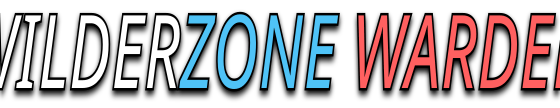

<p align="center">
  
</p>

<p align="center">
  <a href="https://github.com/Tribes2-Community/wilderzone-warden/releases/latest"></a>
  <a href="https://github.com/Tribes2-Community/wilderzone-warden/actions/workflows/release.yml"></a>
  <a href="LICENSE"></a>
</p>

An admin and super-admin console for **Tribes 2** servers running **Classic (1.5.2)** and
**TacoServer**. Press **Ctrl-F9** in a game and get players, match controls, bans, server settings,
TacoServer's admin panel and a message log in one window.

It is a single VL2 that runs on your client. **Nothing is installed on the server:** everything the
console does goes through commands and menus the server already offers, so what you can do is exactly
what your rank allows there.

## Install

1. Download `zz_WilderzoneWarden.vl2` from the [latest release](https://github.com/Tribes2-Community/wilderzone-warden/releases/latest).
2. Copy it into `GameData/base` of your Tribes 2 client and restart the game.
3. Join a server and press **Ctrl-F9** (or bind a key under *Options > Controls > "Wilderzone Warden"*).
   **Esc** closes the console.

To change or remove the Ctrl-F9 binding, set `$pref::Warden::GlobalKey` in the client console
(for example `$pref::Warden::GlobalKey = "ctrl f10";`, or `""` for none) and restart.

## What's in it

| Tab | What it does | Works on |
|---|---|---|
| **Players** | Player list with rank, team, score and ping. Select a player for the actions the server offers you: kick, ban, warn, gag, freeze, mute, team change, observer, admin changes, private message, client info. Destructive actions need a confirming second click. | Any server (Classic adds extended actions) |
| **Match** | The server's vote/admin menu as a list: change mission, time limit, skip, tournament mode, team damage and more, with a filter for long mission lists. | Any server |
| **Bans** | TacoServer's ban/kick list with time left, **Unban** and **Make permanent**. | TacoServer, Super Admin |
| **Server** | Admin login with **saved per-server passwords**, centre/bottom-print broadcast, and Classic's super-admin settings (passwords, player limit, teams, auto-password, rotation, restart). Password fields are masked. | Classic |
| **Panel** | TacoServer's Server Admin Panel (whitelist, auth queue, IP bans, team balancer, stats) with working links. | TacoServer, Super Admin |
| **Log** | Every server message with text, time-stamped. | Any server |
| **About** | Version, credit, and the update check. | Any server |

How each tab talks to the server, and the known limits (all server-side), are written up in
[`src/WilderzoneWarden_readme.txt`](src/WilderzoneWarden_readme.txt).

## Saved logins

On the **Server** tab you can store your Admin and Super Admin passwords **per server**, so you can
elevate with one click without typing, or showing, a password while streaming.

1. Type the password in the (masked) login box and press **SAVE ADMIN** or **SAVE SUPER**.
2. Next time, press **USE ADMIN** or **USE SUPER**. The saved password is sent only to that server.
3. **FORGET SAVED** (with a confirming second click) removes both for the server you are on.

Notes: passwords are keyed by the server address the game joined, so join from the server list (if the
address is unknown the console says so and saves nothing). They are kept in your client prefs file in
**plain text**, so do not share that file. Nothing is ever sent automatically; it only happens when you
press USE ADMIN or USE SUPER.

## Updates

When you first open the console in a session it checks GitHub for a newer release. The **About** tab
shows **Up to Date - 1.1** (with your version) when you are current. If there is a newer one, it and the
**Log** say so, and the **GET UPDATE** button opens the releases page.

The check needs a client whose `HTTPObject` supports HTTPS, such as the **QOL** client. On other
clients it reports that GitHub could not be reached, and the button simply opens the releases page.
Set `$pref::Warden::CheckUpdates = false;` to turn the automatic check off.

## Building

Python 3 is all you need to build the VL2:

```
python tools/pack.py        # writes dist/zz_WilderzoneWarden.vl2
```

Optional: `python tools/make_brand.py <SquadaOne-Regular.ttf> src/textures/gui/warden` redraws the logo, wordmark
and About icon (needs [Pillow](https://python-pillow.org/)). They are drawn from primitives in the
Wilderzone title style: white WILDER, blue ZONE, red WARDEN. [`assets/wilderzone_warden.svg`](assets/wilderzone_warden.svg)
is the same title as vector art.

```
src/scripts/autoexec/    loader
src/scripts/warden/      profiles (skin), gui, core, players, match, panel, server, update
src/textures/gui/warden/ bitmaps
assets/                  title artwork
tools/                   pack.py, make_brand.py
.github/workflows/       release workflow
```

## Releasing

The version lives in one place: `$Warden::Version` in
[`src/scripts/warden/core.cs`](src/scripts/warden/core.cs). To ship a build, bump it (for example to
`"1.1"`) and push to `main`. The [Release workflow](.github/workflows/release.yml) builds the VL2 and
publishes a `v1.1` release with it attached. A push that does not change the version builds nothing.
That release is also what the in-game update check looks for.

## Credits

Created by [GeekOfWires](https://github.com/GeekOfWires), with co-authors Claude Opus 5.5 and
Claude Sonnet 5.5 (Anthropic).

The wordmark is set in [Squada One](https://fonts.google.com/specimen/Squada+One) (SIL Open Font
License), matching `assets/wilderzone_warden.svg`.

Built on Tribes 2 by Dynamix, the admin commands of Classic (z0dd's Admin Hud) and TacoServer's
Server Admin Panel.

## License

[MIT](LICENSE) © GeekOfWires
